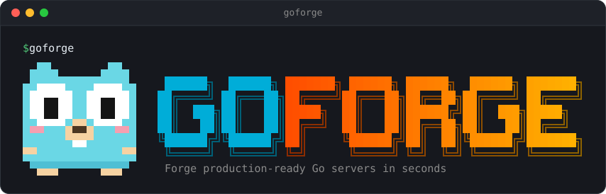

<div align="center">



[](https://github.com/Frank5ive/goforge/actions/workflows/ci.yml)
[](https://github.com/Frank5ive/goforge/releases)
[](https://pkg.go.dev/github.com/Frank5ive/goforge)
[](https://go.dev/)
[](LICENSE)
[](CONTRIBUTING.md)

**Generate production-ready Go REST APIs in one command, on PostgreSQL, MySQL, SQLite, or MongoDB, with tests, CI, and Docker.**
Built for developers and for AI coding agents.

[Features](#-features) •
[Installation](#-installation) •
[Quick Start](#-quick-start) •
[Adding Resources](#-adding-resources) •
[Adding a Database](#-adding-a-database) •
[AI Agents](#-using-goforge-from-an-ai-agent) •
[Documentation](#-documentation) •
[Architecture](#-goforge-architecture) •
[Contributing](#-contributing)

</div>

---

## 🎯 What is GoForge?

GoForge is a CLI that generates production-ready Go HTTP servers and keeps extending them. Use it
when you're starting a Go REST API or microservice and want a solid, tested foundation instead of
writing (or having an AI agent write) the same server, middleware, storage, and tests again.

```bash
go install github.com/Frank5ive/goforge@latest
goforge generate --name shop --module github.com/you/shop --db postgres --yes
cd shop
goforge add resource product --fields "name:string,price:float,in_stock:bool"
go test ./...   # the generated code is tested and lint-clean from the start
```

That gives you a server with graceful shutdown, structured logging, request IDs, CORS, and health
checks; a `products` REST resource with validation, pagination, and tests; a PostgreSQL repository
with migrations; and a Dockerfile, docker-compose.yml, Makefile, and CI workflow. It's plain Go on
the standard library's `net/http`, with no framework to learn.

### When to use it

- **A good fit:** a new Go REST API or microservice; adding CRUD resources to a GoForge project;
  having an AI agent build a Go backend without spending tokens writing infrastructure.
- **Not a fit (yet):** gRPC or GraphQL services, server-rendered web apps, or adding GoForge to an
  existing project it didn't generate.

### Why GoForge?

✅ **Production Ready** - Graceful shutdown, request IDs, panic recovery, and timeouts  
✅ **Grows With You** - `goforge add resource` generates CRUD endpoints, storage, business logic, and tests  
✅ **No Framework** - Generated servers use the standard library; the only dependency is your database driver  
✅ **Tested and Linted** - Generated projects ship with tests and pass their own golangci-lint config  
✅ **Verified Output** - Every option combination is generated, linted, tested, built, and booted by GoForge's test suite  
✅ **Ready for CI/CD** - Optional GitHub Actions workflow and non-root Docker image  

---

## 🚀 Features

### Core Features
- 🔌 **Health and Readiness** - `GET /health` for liveness and `GET /readyz` for readiness (checks dependencies such as the database)
- 🛑 **Graceful Shutdown** - Handles SIGINT/SIGTERM and drains in-flight requests
- 🧭 **Modern Routing** - Go 1.22+ `http.ServeMux` patterns like `GET /users/{id}`, with automatic 405s
- 🪪 **Request IDs** - Every response carries an `X-Request-ID`, incoming IDs are reused for tracing, and every log line for a request includes it
- 🔎 **Traceable Errors** - Error responses include the request ID; unexpected errors are logged with their cause, and with `APP_ENV=development` the response shows it too
- 🧯 **Panic Recovery** - Panics become JSON 500s and are logged with a stack trace
- ⏱️ **Timeouts** - Read, write, idle, and read-header timeouts
- ⚙️ **12-Factor Config** - A `config` package loads `APP_ENV`, `PORT`, `CORS_ALLOWED_ORIGINS`, `MAX_BODY_BYTES`, and `SHUTDOWN_TIMEOUT` from the environment
- 🌐 **CORS** - Opt-in with `CORS_ALLOWED_ORIGINS`, including preflight handling
- 📏 **Body Limits** - Request bodies are capped (1 MiB by default) and oversized ones get `413`
- 🧰 **JSON Helpers** - `WriteJSON`, `WriteError`, and a strict `DecodeJSON` that rejects unknown fields
- 🧪 **Tests and Tooling** - Handler and middleware tests, a Makefile, and a golangci-lint config

### Optional Features
- 📝 **Structured Logging** - `log/slog` in text or JSON, with one log line per request
- 🐳 **Docker** - Multi-stage build, non-root user, health check, and `.dockerignore`
- 🤖 **GitHub Actions CI** - Vet, race-enabled tests, lint, and Docker build
- 📖 **README** - Documentation for the generated project

---

## 📦 Installation

### Option 1: Go Install

Requires Go 1.26 or newer to install GoForge. Generated projects need Go 1.24 or newer.

```bash
go install github.com/Frank5ive/goforge@latest
```

### Option 2: Download a Binary

Prebuilt binaries for Linux, macOS, and Windows (amd64 and arm64) are on the
[releases page](https://github.com/Frank5ive/goforge/releases), with a `checksums.txt` to verify them.

```bash
# Linux/macOS: extract and move onto your PATH
tar -xzf goforge_*_linux_amd64.tar.gz
sudo mv goforge /usr/local/bin/

# Windows: extract the .zip and add goforge.exe to your PATH
```

### Option 3: Build from Source

```bash
git clone https://github.com/Frank5ive/goforge.git
cd goforge
go build -o goforge .
```

### Shell Completion

Tab-complete commands and flags in bash, zsh, fish, or PowerShell:

```bash
# bash (current session; add to ~/.bashrc to keep it)
source <(goforge completion bash)

# zsh
goforge completion zsh > "${fpath[1]}/_goforge"

# fish
goforge completion fish > ~/.config/fish/completions/goforge.fish
```

Run `goforge completion <shell> --help` for details.

---

## ⚡ Quick Start

### Generate Your First Server

```bash
# Interactive mode: prompts for the module path and features
goforge generate --name=my-api

# Non-interactive mode (scripts and CI)
goforge generate --name=my-api --module=github.com/you/my-api --yes

# Preview the files without writing anything
goforge generate --name=my-api --dry-run --yes
```

### Run Your Server

```bash
cd my-api
go run .
```

Your server is now running at `http://localhost:8080` 🎉

### Test the Health Endpoint

```bash
curl http://localhost:8080/health
```

**Response:**
```json
{
  "status": "healthy",
  "timestamp": "2024-11-02T16:43:58Z",
  "service": "my-api"
}
```

---

## 🤖 Using GoForge from an AI Agent

GoForge is designed to be run by AI coding agents as well as people. If you're an agent building a
Go backend, use GoForge for the infrastructure and spend your effort on the business logic:

1. **Pass `--json` to any command** to get its result as JSON on stdout: the files created and
   updated, endpoints, notes, and next steps. Commands never wait for input: without a terminal
   (or with `--json` or `--yes`), `generate` uses the flag values and defaults instead of prompting.
   Set every option with flags:
   `goforge generate --name <app> --module <module-path> [--db postgres|mysql|sqlite|mongo] --json`
2. **Add each REST resource with one command** instead of writing handlers, storage, and tests:
   `goforge add resource <name> --fields "field:type,..."`. Types are `string`, `int`, `float`,
   `bool`, and `time`; a trailing `?` makes a string optional. Routes are registered automatically.
3. **Add a database** with `goforge add db <postgres|mysql|sqlite|mongo>`. Existing resources move
   onto it.
4. **Preview first** with `--dry-run` on any command; it lists every file it would create or change.
5. **Verify** with `go test ./...` (and `make lint`). Generated projects pass both.
6. **Leave the `// goforge:` marker comments in place.** GoForge edits files only at those markers,
   and `.goforge.json` records the project's resources and database; both let later `goforge add`
   commands extend the project safely. Every command changes all files or none.

A failed command exits with status 1. With `--json`, it prints `"ok": false` and an `error` with a
stable `code`, a `message`, and a `hint` on how to fix it:

```json
{
  "command": "add resource",
  "ok": false,
  "dry_run": false,
  "created": [],
  "updated": [],
  "error": {
    "code": "not_a_goforge_project",
    "message": ". is not a Go module; run this inside a project created by goforge generate: ...",
    "hint": "Run the command inside a project created by `goforge generate`, or point --dir at one."
  }
}
```

| Code | Meaning |
|------|---------|
| `invalid_arguments` | Unknown flag, or a missing or extra argument |
| `invalid_input` | A name, field, type, or option value isn't valid |
| `not_a_goforge_project` | The directory isn't a project created by `goforge generate` |
| `already_exists` | The project, resource, or database already exists |
| `marker_missing` | A file lost a `// goforge:` marker comment GoForge needs to update it |
| `dependency_failed` | Adding the database driver with `go get` failed (nothing was changed) |
| `write_failed` | A file or directory couldn't be written |
| `cancelled` | The interactive prompts were cancelled |
| `internal_error` | Anything else |

A compact reference for language models is in [`llms.txt`](llms.txt).

---

## 🧩 Adding Resources

Inside a project created by `goforge generate`, add a complete REST resource with one command:

```bash
goforge add resource product --fields "name:string,price:float,in_stock:bool,image_url:string?"
```

```
✅ Added the product resource. Created 7 files:
   products/product.go         # Product model, Input, Patch, validation rules, Repository interface
   products/memory.go          # Thread-safe in-memory Repository
   products/service.go         # Business logic: list, get, create, update, patch, delete
   products/handler.go         # HTTP handlers and route registration
   products/service_test.go
   products/handler_test.go
   products/requests.http      # Example requests to run from your editor

📝 Updated:
   server/routes.go            # Routes registered automatically

🌐 Endpoints:
   GET    /products?limit=20&offset=0
   POST   /products
   GET    /products/{id}
   PUT    /products/{id}
   PATCH  /products/{id}
   DELETE /products/{id}
```

**Ready to go:** the routes are registered in `server/routes.go` for you, so the endpoints
work as soon as you start (or restart) the server with `go run .`. No wiring needed. Open
`products/requests.http` in VS Code (REST Client extension) or a JetBrains IDE to try every
endpoint with one click; it already points at your project's port.

Each resource uses Clean Architecture–style layering in a single package: handlers call
the service, the service holds the business rules, and storage sits behind a `Repository`
interface, so resources move to a database (see [Adding a Database](#-adding-a-database))
without touching the service or handlers. Keeping a resource in one package makes it easy to
find and follow.

**Fields** are `name:type` pairs. Types: `string`, `int`, `float`, `bool`, and `time`
(RFC 3339 in JSON). String fields are required unless marked optional with `?`. `id`,
`created_at`, and `updated_at` are added automatically.

**Listing** is paginated: `GET /products?limit=20&offset=40` returns
`{"items": [...], "total": 57, "limit": 20, "offset": 40}`, oldest first. `limit` defaults to
20 and is capped at 100.

**Updating:** `PUT` replaces every editable field, while `PATCH` changes only the fields you
send (`{"price": 24.5}`). Both run the same validation rules.

**Responses:** `201` with a `Location` header on create, `204` on delete, `404` for unknown
IDs, `422` with every failed rule listed (`{"error":"invalid product: name is required"}`),
and `400` for malformed JSON, unknown fields, or invalid `limit`/`offset`.

| Flag | Short | Default | Description |
|------|-------|---------|-------------|
| `--fields` | `-f` | `name:string` | Comma-separated `name:type` fields |
| `--plural` | | derived | Plural for irregular words, e.g. `--plural people` for `person` |
| `--dir` | `-d` | `.` | Project directory (the one containing `go.mod`) |
| `--dry-run` | | `false` | Show the files that would be created or changed |
| `--json` | | `false` | Print the result as JSON, for scripts and AI agents |

---

## 🐘 Adding a Database

Store your resources in a real database with one command, either when generating
(`goforge generate --db <engine>`) or later, inside an existing project:

```bash
goforge add db postgres    # or: mysql, sqlite, mongo
make db-up                 # start the database in Docker (not needed for SQLite)
go run .                   # connects and serves your resources from the database
```

| Engine | Command | Driver | Local database | Good for |
|--------|---------|--------|----------------|----------|
| **PostgreSQL** | `goforge add db postgres` | [pgx](https://github.com/jackc/pgx) | `postgres:18` in Docker | Most production APIs |
| **MySQL / MariaDB** | `goforge add db mysql` | [go-sql-driver/mysql](https://github.com/go-sql-driver/mysql) | `mysql:8.4` in Docker | Teams already on MySQL or MariaDB |
| **SQLite** | `goforge add db sqlite` | [modernc.org/sqlite](https://pkg.go.dev/modernc.org/sqlite) (pure Go) | A file; no server or Docker | Prototypes, small apps, single-server tools |
| **MongoDB** | `goforge add db mongo` | [mongo-driver v2](https://github.com/mongodb/mongo-go-driver) | `mongo:8.0` in Docker | Document-shaped data |

Aliases work too: `postgresql`, `mariadb`, `sqlite3`, `mongodb`.

What `add db` does, for every engine:

- **Adds a `db` package** that connects at startup, checks the database is reachable, and
  closes it on shutdown. For SQL databases it also runs migrations: SQL files in
  `db/migrations` are embedded in the binary and applied in order at startup, each once,
  behind a lock so two instances never migrate at the same time.
- **Moves every existing resource to the database.** Each gets a repository for the engine
  and, for SQL databases, a migration that creates its table. **Resources you add afterwards
  use the database automatically.**
- **Wires it in:** `DATABASE_URL` joins the `config` package (it defaults to the local
  development database), and `/readyz` returns `503` when the database is unreachable.
- **Proves both storage layers behave the same:** each resource's `repository_test.go` runs
  one set of tests against the in-memory and the database repositories. SQLite's tests always
  run, on a temporary file. The others run when `TEST_DATABASE_URL` is set; `make test-db`
  runs everything against the database in Docker.
- **Adds local tooling and CI:** `docker-compose.yml` (the database, plus the app when the
  project has a Dockerfile), `make db-up`, `db-down`, `db-reset`, and `test-db`, and a database
  service in the generated GitHub Actions workflow. SQLite needs none of this: its
  `make db-reset` deletes the file, and the files are git-ignored.
- **Adds the driver to `go.mod`.** The project's minimum Go version rises to what the driver
  requires (Go 1.25 for PostgreSQL and MongoDB, Go 1.26 for SQLite).

Edits are made only at marker comments and are all planned before anything is written. If
any step fails, including downloading the driver, the project is left exactly as it was. Use
`--dry-run` to preview the changes, and `--json` for a machine-readable result.

> **Already running a database locally?** The Docker databases use the standard ports
> (5432, 3306, 27017). If one is taken, stop the local server or change the port in
> `docker-compose.yml` and `DATABASE_URL`.

> **MongoDB on Linux 6.19 to 7.0.13.** MongoDB refuses to start on these kernels while
> its allocator uses `rseq` ([SERVER-121912](https://jira.mongodb.org/browse/SERVER-121912)).
> The generated `docker-compose.yml` and CI service set `GLIBC_TUNABLES=glibc.pthread.rseq=1`,
> which hands `rseq` to glibc so MongoDB starts at a small cost in allocator speed. Set the
> same variable for a MongoDB you run some other way, or use kernel 7.0.14 or later.

---

## 📚 Documentation

### Command Line Options

```bash
goforge generate [flags]
```

#### Flags

| Flag | Short | Default | Description |
|------|-------|---------|-------------|
| `--name` | `-n` | `myapp` | Name of the application (also the project directory) |
| `--module` | `-m` | app name | Go module path, e.g. `github.com/acme/my-api` |
| `--port` | `-p` | `8080` | Default port (the `PORT` env var overrides it at runtime) |
| `--output` | `-o` | `.` | Directory to create the project in |
| `--logger` | | `true` | Include request logging |
| `--docker` | | `true` | Include a Dockerfile |
| `--readme` | | `true` | Include a README.md |
| `--yes` | `-y` | `false` | Skip prompts and use flag values and defaults |
| `--dry-run` | | `false` | List the files that would be created without writing anything |
| `--git` | | `false` | Run `git init` in the new project |
| `--db` | | none | Store data in a database: `postgres`, `mysql`, `sqlite`, or `mongo` (same as `goforge add db <engine>`) |
| `--json` | | `false` | Print the result as JSON, for scripts and AI agents (implies no prompts) |

#### Interactive Prompts

When running in a terminal without `--yes`, GoForge asks for anything not already set by flag:

1. **Go module path** - Leave empty to use the app name
2. **Features** - Toggle request logging, Dockerfile, and README

Prompts only appear for a person at a terminal. With `--yes` or `--json`, or when input isn't a
terminal (scripts, CI, and AI agents), GoForge uses the flag values and defaults instead.
If generation fails partway, GoForge removes the partially created project directory.

### Examples

#### Basic Server

```bash
goforge generate --name=hello-api --port=3000
```

#### Minimal Server Without Docker or Logging

```bash
goforge generate --name=worker --logger=false --docker=false --yes
```

#### CI/CD Ready

```bash
goforge generate --name=ci-api --module=github.com/acme/ci-api --output=./services --yes --git
```

---

## 🏗️ Generated Project Structure

```
my-api/
├── main.go                    # Entry point: startup and graceful shutdown
├── config/                    # Settings from environment variables
├── server/
│   ├── server.go              # HTTP server and middleware chain
│   ├── routes.go              # Route registration (add endpoints here)
│   ├── middleware.go          # Request ID, panic recovery, request logging
│   └── server_test.go
├── handlers/
│   ├── health.go              # GET /health
│   ├── respond.go             # JSON response helper
│   └── health_test.go
├── logger/                    # slog setup from LOG_LEVEL / LOG_FORMAT (optional)
├── Makefile                   # run, build, test, cover, lint, docker-build, ...
├── .golangci.yml              # golangci-lint v2 config
├── .github/workflows/ci.yml   # GitHub Actions CI (optional)
├── Dockerfile                 # Multi-stage, non-root (optional)
├── .dockerignore              # (optional)
├── README.md                  # (optional)
├── .gitignore
└── go.mod
```

---

## 🎨 GoForge Architecture

GoForge itself is built following **Clean Architecture** principles:

```
┌─────────────────────────────────────────────┐
│            External Interfaces              │
│  (HTTP Handlers, CLI, Database Adapters)    │
└──────────────────┬──────────────────────────┘
                   │
┌──────────────────┴──────────────────────────┐
│         Application Business Rules          │
│              (Use Cases)                    │
└──────────────────┬──────────────────────────┘
                   │
┌──────────────────┴──────────────────────────┐
│        Enterprise Business Rules            │
│          (Entities, Interfaces)             │
└─────────────────────────────────────────────┘
```

### Key Principles

✅ **Dependency Inversion** - Core logic doesn't depend on frameworks  
✅ **Separation of Concerns** - Each layer has a single responsibility  
✅ **Testability** - Easy to mock and test components  
✅ **Flexibility** - Swap implementations without affecting business logic  

---

## 🔧 Advanced Usage

### Custom Port Configuration

```bash
goforge generate --name=custom-api --port=3000
```

### Generate Multiple Services

```bash
# User service
goforge generate --name=user-service --port=8001 --output=./services

# Order service
goforge generate --name=order-service --port=8002 --output=./services

# Payment service
goforge generate --name=payment-service --port=8003 --output=./services
```

### Docker Deployment

```bash
# Generate with Dockerfile
goforge generate --name=my-api --port=8080
cd my-api

# Build Docker image
docker build -t my-api:latest .

# Run container
docker run -p 8080:8080 my-api:latest

# Test
curl http://localhost:8080/health
```

---

## 🧪 Testing

GoForge's test suite generates a project for every combination of options using the
real embedded templates, then checks that each one is gofmt-clean, passes `go vet`,
compiles, serves `/health`, and shuts down gracefully on `SIGTERM`.

```bash
# Full suite, including the end-to-end generation test
go test ./...

# Skip the end-to-end test for a quick run
go test -short ./...
```

---

## 🛠️ Development

### Project Stack

- **Language**: Go 1.26+
- **CLI Framework**: Cobra
- **Interactive Prompts**: Huh
- **Architecture**: Clean Architecture
- **Testing**: Go testing package
- **Template Engine**: Go text/template

### Building GoForge

```bash
# Clone repository
git clone https://github.com/Frank5ive/goforge.git
cd goforge

# Install dependencies
go mod download

# Build
go build -o goforge .

# Run tests
go test ./...

# Run with coverage
go test -cover ./...
```

### Project Structure

```
goforge/
├── cmd/                    # CLI commands (Cobra)
├── internal/
│   ├── domain/            # Business entities & interfaces
│   ├── usecase/           # Application logic
│   ├── infrastructure/    # Template & file operations
│   └── di/                # Dependency injection
├── templates/             # Go server templates
└── main.go               # Entry point
```

See [ARCHITECTURE.md](ARCHITECTURE.md) for how generation works and how to add templates or options.

---

## 🤝 Contributing

We welcome contributions! Here's how you can help:

### Ways to Contribute

- 🐛 **Report Bugs** - Open an issue with reproduction steps
- ✨ **Suggest Features** - Share your ideas for improvements
- 📖 **Improve Documentation** - Fix typos, add examples
- 🔧 **Submit PRs** - Fix bugs or implement features

### Contribution Process

1. Fork the repository
2. Create your feature branch (`git checkout -b feature/amazing-feature`)
3. Commit your changes (`git commit -m 'Add amazing feature'`)
4. Push to the branch (`git push origin feature/amazing-feature`)
5. Open a Pull Request

### Development Guidelines

- Follow Clean Architecture principles
- Write tests for new features
- Update documentation
- Keep commits atomic and descriptive
- Run `go fmt` and `go vet` before committing

---

## 📝 License

This project is licensed under the **MIT License** - see the [LICENSE](LICENSE) file for details.

### What This Means

✅ Commercial use allowed  
✅ Modification allowed  
✅ Distribution allowed  
✅ Private use allowed  

---

## 🙏 Acknowledgments

- Inspired by [Clean Architecture](https://blog.cleancoder.com/uncle-bob/2012/08/13/the-clean-architecture.html) by Uncle Bob
- Built with [Cobra](https://github.com/spf13/cobra) CLI framework
- Uses [Huh](https://github.com/charmbracelet/huh) for interactive prompts
- The Go gopher was designed by [Renée French](https://reneefrench.blogspot.com/) and is licensed under [CC BY 4.0](https://creativecommons.org/licenses/by/4.0/). The pixel-art gopher in GoForge's terminal banner is adapted from it.

---

## 📮 Support & Contact

- 🐛 **Issues**: [GitHub Issues](https://github.com/Frank5ive/goforge/issues)
- 💬 **Discussions**: [GitHub Discussions](https://github.com/Frank5ive/goforge/discussions)

---

## ⭐ Star History

If you find GoForge useful, please consider giving it a star! ⭐

It helps others discover the project and motivates continued development.

---

## 🗺️ Roadmap

### v0.1 (Released)
- ✅ Server generation with health checks, graceful shutdown, and middleware
- ✅ Structured logging, tests, linting, CI, and Docker
- ✅ Environment-based configuration, CORS, and request body limits
- ✅ `goforge add resource` for tested CRUD resources
- ✅ Databases: PostgreSQL, MySQL/MariaDB, SQLite, and MongoDB (`goforge add db <engine>`)

### Next
- [ ] **v0.2: Discoverable and agent-ready.** `--json` output, `goforge inspect` and `goforge check`,
  visible errors in generated projects, `AGENTS.md`, and a published benchmark
- [ ] **v0.3: In the agent ecosystem.** An agent skill, an MCP server, OpenAPI generated from
  resources, and a Homebrew tap
- [ ] **v0.4: Production features.** Authentication, filtering and sorting, field rules, and
  OpenTelemetry tracing with Prometheus metrics

### Later
- [ ] gRPC, WebSockets, and event-driven messaging
- [ ] Kubernetes manifests
- [ ] GraphQL

See [ROADMAP.md](ROADMAP.md) for the details of each phase.

---

<div align="center">

**Built with ❤️ by Frank Gondwe**

[⬆ Back to Top](#top)

</div>
